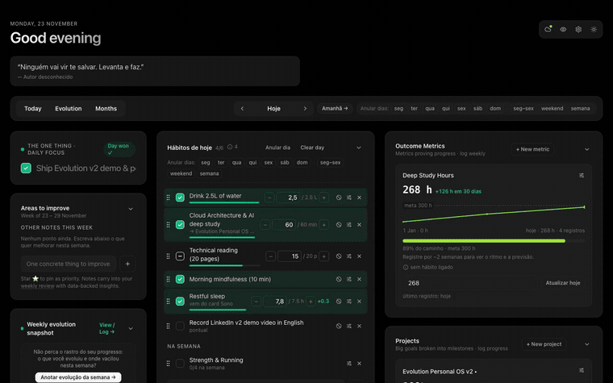
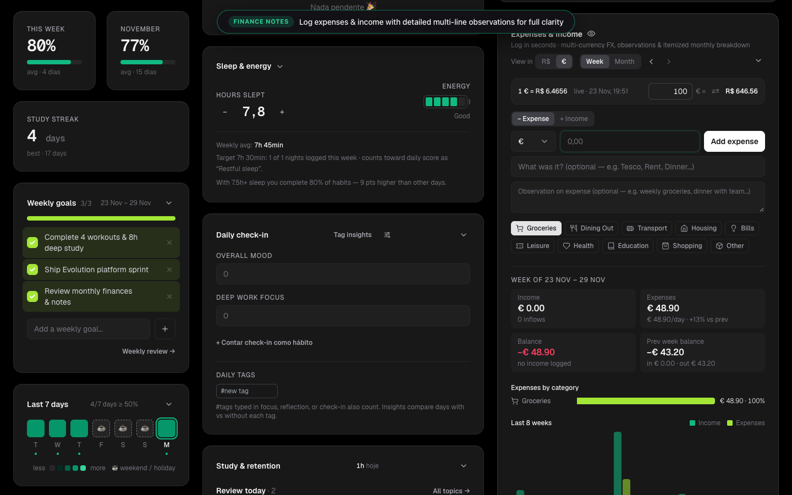
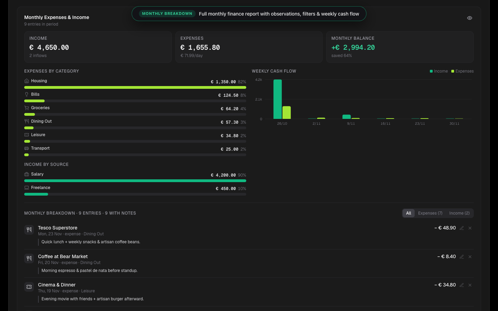
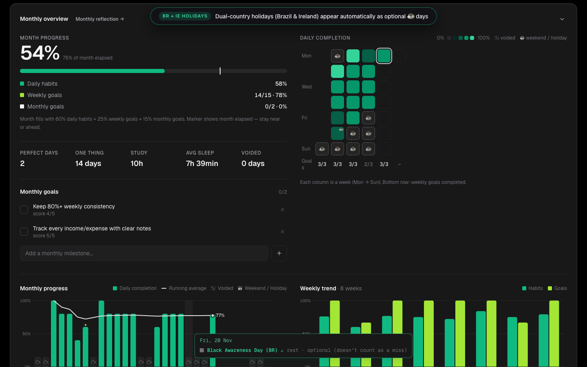
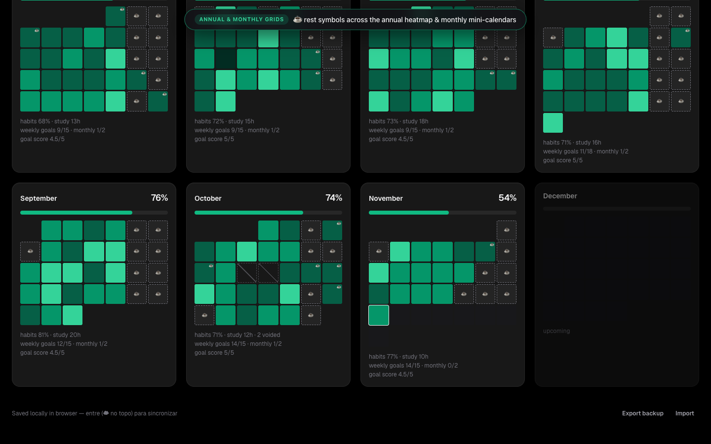

# Evolution Dashboard (`painel-pessoal`)

Minimalist, local-first personal operating system for **habits, goals, studies, sleep telemetry, multi-currency finance, travel history, and weekly self-reviews** — built as a zero-build single-file web application.


[](media/painel-pessoal-demo-en.mp4)

<p align="center">
  <a href="media/painel-pessoal-demo-en.mp4">▶ Watch full 1440×900 MP4 demo</a>
</p>

---

## Key Features

### 1. Daily Execution, Habits & Study Retention
- **Weighted Habit Tracking & Streaks:** Log daily habits, review completion scores across the week and month, and track study streaks (`Best` vs. `Current`).
- **Spaced Study Review (`Study & retention`):** Manage topics you are learning with scheduled daily review queues.
- **Sleep & Energy Correlation:** Log nightly sleep duration and energy ratings, comparing your completion rate on well-rested days versus low-sleep days.
- **Daily Check-in & `#tag` Insights:** Score mood and deep work focus while tagging days (`#deepwork`, `#travel`, etc.) to measure how specific routines impact output.

### 2. Multi-Currency Finance & Cash Flow Analytics
- **Live Currency Conversion (`R$`, `€`, `US$`, `£`):** Fetches live FX rates via the Frankfurter API so expenses and income in multiple currencies convert seamlessly into your chosen view currency.
- **Itemized Breakdown & Observations:** Record multi-line notes per expense/income, filter monthly ledgers (`All`, `Expenses`, `Income`), edit categories on the fly, and visualize weekly cash flow and spending by category.

### 3. Annual & Monthly Heatmaps with Holiday Awareness
- **Yearly & Monthly Completion Grids:** Visualize an entire year of habits, study hours, weekly targets, and goal scores at a glance.
- **Smart Weekend & Dual-Country Holidays:** Built-in support for optional rest days (marked with `☕` icons, including Brazil & Ireland public holidays) so scheduled rest never penalizes consistency metrics.

### 4. World Travel Map, Weekly Reviews & Zero-Lock-In Sync
- **Interactive Countries Map:** Vector world map built with `d3-geo` and `world-atlas` to log countries visited and trips.
- **Structured Weekly Reflection:** Guided review cards highlighting wins, misses, month-over-month improvements, and next-week focus.
- **Local-First + Optional Cloud Sync:** Runs completely offline using browser `localStorage` (`evolution-dashboard-v1`), with one-click **JSON backup export/import** plus optional multi-device sync powered by **Supabase** and theme/accent customization.

---

## Screenshots

| Finance & Live FX Panel | Monthly Cash Flow Report |
| --- | --- |
|  |  |

| Monthly Analytics & Holiday Awareness | Annual & Monthly Heatmaps |
| --- | --- |
|  |  |

---

## Getting Started

No Node modules, bundler, or build step required.

### Option A — Open Directly in Your Browser

```bash
git clone https://github.com/leonardogtcruz1/painel-pessoal.git
cd painel-pessoal
open index.html
```

### Option B — Serve Locally Over HTTP

```bash
python3 -m http.server 8080
# Open http://localhost:8080
```

> All dashboard data stays privately in your browser's `localStorage` by default; optional Supabase credentials can be configured inside the app's **Account & Sync** modal.

---

## Tech Stack

| Layer | Technologies |
| --- | --- |
| **Core** | Vanilla JavaScript (ES6+), Semantic HTML5 |
| **Styling & Typography** | Tailwind CSS (CDN), Geist & Geist Mono |
| **Data & Maps** | `d3-geo` + `world-atlas`, Frankfurter FX API, `localStorage` JSON state |
| **Optional Cloud Sync** | `@supabase/supabase-js` |

---

## Author

**Leonardo Cruz** — [GitHub](https://github.com/leonardogtcruz1)
